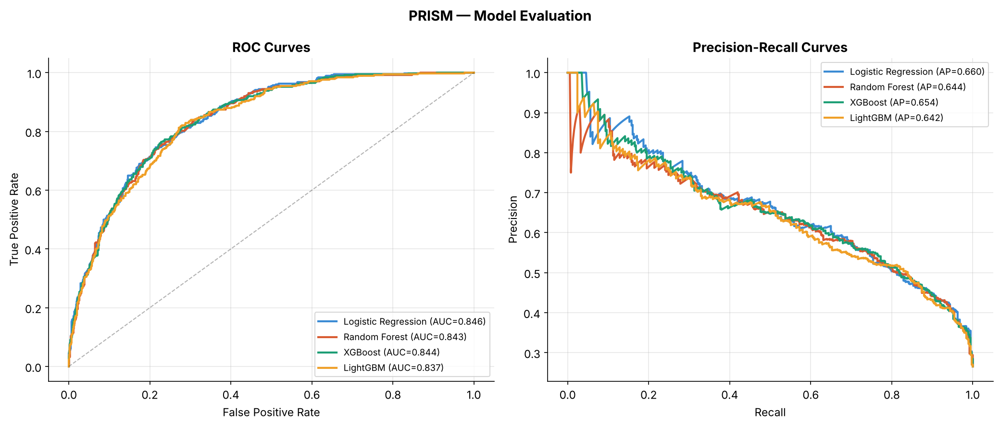
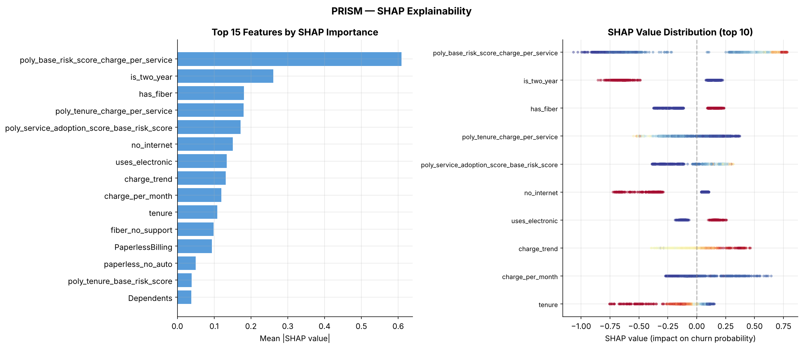

# PRISM: Predictive Revenue Intelligence Signal Monitor

An end-to-end churn analysis project: it predicts which telecom customers are likely to leave, estimates the revenue at risk, and serves the results through an API and a dashboard.

**Dataset:** the public IBM Telco Customer Churn sample (7,043 customers, 21 raw columns; the raw CSV is in `data/raw/`). It is a single snapshot with no dates or event logs, so this project predicts *who* is likely to churn. It does not measure *when* churn will happen.

## Results (held-out test set, 1,409 customers never used for training)

Split: stratified random 80/20, so train and test both have a 26.5% churn rate. The best model was chosen by 5-fold cross-validation on the training data, and each model's probability cut-off was also chosen on the training data only. The test set was used once, to report the scores below.

| Model | ROC-AUC | Precision | Recall | F1 | Cut-off |
|---|---|---|---|---|---|
| **Logistic Regression (deployed)** | **0.846** | 0.56 | 0.72 | 0.63 | 0.59 |
| XGBoost (tuned with Optuna) | 0.844 | 0.54 | 0.77 | 0.64 | 0.55 |
| Random Forest | 0.843 | 0.55 | 0.75 | 0.63 | 0.54 |
| LightGBM | 0.837 | 0.54 | 0.74 | 0.62 | 0.50 |

- **The simple model wins.** Logistic regression has the best cross-validated AUC (0.848 against 0.846 for tuned XGBoost). The first three models are within 0.003 AUC of each other, which is inside the noise for a test set this size, so no model is clearly better. When models tie, the simpler and more explainable one is the sensible choice.
- **Targeting:** the 20% of customers the model ranks highest contain about 50% of all customers who actually churned (roughly 2.5x better than picking at random).
- **High-risk group:** 469 test customers have a predicted churn probability of 0.6 or more. About 56% of them did churn. Their combined monthly charges are about $36.5k.
- **What drives churn** (XGBoost feature importance): new customers, contract length (one-year and two-year contracts lower churn), and fiber internet, especially without tech support.

The SHAP chart explains the XGBoost model, because SHAP's fast tree explainer needs a tree model. The deployed logistic regression can be read directly from its coefficients.




## What is real and what is simulated

- **Model results above:** real, measured on held-out customers.
- **A/B test (phase 4): simulated.** Outcomes are drawn from the model's probabilities, and the treatment group is *given* an assumed 15% churn reduction. The p-values and dollar figures show how a test would be analysed. They are not evidence that a retention offer works. The dashboard page is labelled the same way.
- **ROI columns:** based on two assumptions, a $50 cost per retention offer and a 15% save rate. Neither is measured.
- **Monitoring (phase 6b):** compares training rows with held-out rows to demonstrate the method. The dataset has no time dimension, so real drift cannot occur.
- **Airflow DAG:** an example schedule. It was not deployed.

## Pipeline

| Phase | Script | What it does |
|---|---|---|
| 1 | `phase1_data_engineering.py` | Cleans the raw CSV, engineers features, selects 30 of them (mutual information, then iterative VIF), builds the feature store |
| 2 | `phase2_eda.py` | Hypothesis-driven EDA, charts 01-06 |
| 2b | `phase2b_survival.py` | Kaplan-Meier and Cox survival models |
| 2c | `phase2c_clustering.py` | K-Means churn archetypes |
| 3 | `phase3_modeling.py` | Trains 4 models, tunes XGBoost, picks the best by cross-validation, SHAP, saves the test split and predictions |
| 4 | `phase4_ab_testing.py` | Simulated A/B test analysis |
| 5 | `phase5_api.py` | FastAPI prediction service (`/predict`, `/predict/batch`, `/health`) |
| 6 | `phase6_sql_analysis.py` | DuckDB analytical queries |
| 6b / 6c | `phase6b_monitoring.py`, `phase6c_pipeline.py` | Drift and performance monitoring, pipeline runner |
| - | `dashboard.py` | Streamlit dashboard |

## Run it

```bash
pip install -r requirements.txt     # tested on Python 3.12
./run_all.sh                        # runs phases 1 to 6c from the raw CSV in data/raw/
streamlit run dashboard.py          # dashboard
uvicorn phase5_api:app --reload     # API docs at http://127.0.0.1:8000/docs
pytest -q                           # consistency tests
```

Re-run `phase3_modeling.py` after installing so the saved model files match your library versions.

## About the macro signals

Phase 1 also fetches country-level numbers (GDP growth, inflation, unemployment, Google Trends, sector performance). Each one is a single value copied onto every customer, so it cannot help tell customers apart. They are kept in `data/telco_cleaned.csv` for reference but excluded from the model. If the live APIs are unreachable, phase 1 reuses the values saved in `data/macro_signals.json`.

## Known limitations

- Static public dataset, so no true time-based validation and no real intervention data.
- Predictions use customer attributes only (contract, charges, services). No usage or support-ticket history is available.
- One train/test split; the metrics have no confidence intervals, and the gaps between the top models are within noise.
